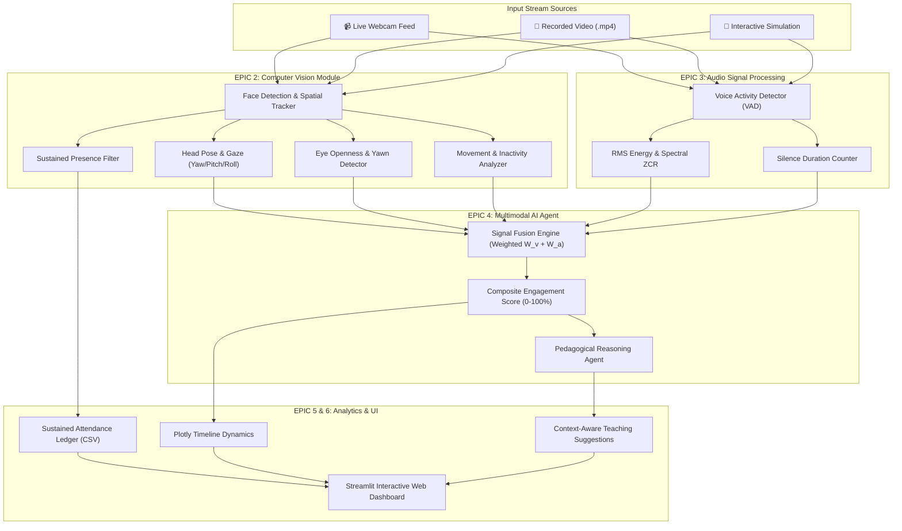

# 🎓 Multimodal Attendance & Engagement Agent

[](https://www.python.org/)
[](https://opencv.org/)
[](https://streamlit.io/)
[]()

> **An AI-powered, privacy-preserving classroom intelligence system integrating Computer Vision, Audio Signal Processing, and Agent-Based Reasoning.**  
> Designed to operate entirely offline to track attendance based on sustained presence, analyze multidimensional engagement trends, and generate AI-driven pedagogical suggestions for educators.

---

## 📌 Table of Contents
- [Project Overview](#project-overview)
- [Core Scenarios Implemented](#core-scenarios-implemented)
  - [Scenario 1: Automated Attendance Tracking](#scenario-1-automated-attendance-tracking)
  - [Scenario 2: Engagement and Session Dynamics Analysis](#scenario-2-engagement-and-session-dynamics-analysis)
  - [Scenario 3: AI-Driven Teaching Suggestions](#scenario-3-ai-driven-teaching-suggestions)
- [Project EPICS Mapping](#project-epics-mapping)
- [System Architecture](#system-architecture)
- [Project Directory Structure](#project-directory-structure)
- [Quickstart & Installation](#quickstart--installation)
- [Usage Guide](#usage-guide)
  - [1. Running Streamlit Web Dashboard](#1-running-the-streamlit-web-dashboard)
  - [2. Running the Headless Demo Verification](#2-running-the-headless-demo-verification)
  - [3. Running Unit Tests](#3-running-the-unit-test-suite)
- [Offline Privacy-Preserving Compliance](#offline-privacy-preserving-compliance)

---

## 📖 Project Overview
In educational institutions and professional training environments, attendance tracking remains largely manual or limited to basic biometric systems that fail to capture meaningful engagement and participation context. These traditional approaches are time-consuming, prone to inaccuracies, and provide no insight into learner attention, interaction patterns, or session effectiveness.

As classrooms increasingly adopt digital tools, there is a growing need for intelligent systems that can move beyond simple presence detection. The **Multimodal Attendance & Engagement Agent** integrates:
1. **Computer Vision:** Continuous facial tracking, head pose gaze estimation, eye closure / blink / yawn fatigue detection, and optical movement dynamics.
2. **Audio Signal Processing:** Root-Mean-Square (RMS) acoustic energy analysis and Voice Activity Detection (VAD) for discussion and silence tracking.
3. **Agent-Based Reasoning:** Multimodal signal fusion and a cognitive pedagogical agent generating real-time, non-intrusive teaching suggestions.

---

## 🎯 Core Scenarios Implemented

### Scenario 1: Automated Attendance Tracking
- **Sustained Presence Verification:** Rejects momentary walk-bys, transient glitches, or passers-by by tracking cumulative presence against a configurable temporal threshold (e.g., minimum 12 seconds sustained presence or $>55\%$ of total session duration).
- **Automated Ledger:** Records `Student ID`, `Student Name`, `Roll No`, `First Seen Timestamp`, `Last Seen Timestamp`, `Active Duration (s)`, and assigns final statuses: `PRESENT`, `LATE / PARTIAL`, or `ABSENT (Walk-By / Below Min Time)`.
- **Export Formats:** Direct export to CSV and JSON attendance records.

### Scenario 2: Engagement and Session Dynamics Analysis
- **Head Pose Estimation:** Determines 3D rotation angles (Yaw, Pitch, Roll) using 2D face geometry & perspective-n-point (PnP). Classifies orientation (*Forward Attentive, Looking Left/Right, Looking Down at Notes/Phone*).
- **Drowsiness & Fatigue Detection:** Evaluates eye openness, blink frequency, and mouth opening (yawn detection).
- **Physical Inactivity & Movement:** Measures optical flow / pixel displacement to differentiate calm attention from fidgeting or frozen inactivity (potential sleeping).
- **Acoustic Interaction Tracking:** Discriminates active vocal discussions, Q&A bursts, and prolonged silence.
- **Multimodal Signal Fusion:** Computes normalized composite engagement scores ($0 - 100\%$) at both individual and classroom levels.

### Scenario 3: AI-Driven Teaching Suggestions
- **Cognitive Rule Engine:** An assistive, non-intrusive decision-support agent observing rolling timeline trends.
- **Pedagogical Actions:**
  - *Attention Recovery:* Triggers when engagement drops below $42\%$ or falls $>18\%$ over 3 minutes $\rightarrow$ suggests pausing monologue and asking a check-for-understanding question.
  - *Fatigue Mitigation:* Triggers when $\ge 2$ learners display sustained eye closure or yawning $\rightarrow$ suggests a 90-second stretch or physical posture reset.
  - *Silence Intervention:* Triggers when quiet interval $>15$s follows concept explanation $\rightarrow$ suggests low-stakes open prompting.
  - *Discussion Momentum:* Triggers during lively Q&A interaction peaks $\rightarrow$ suggests synthesizing peer arguments on board and prompting counter-examples.

---

## 🏆 Project EPICS Mapping

| Epic | Title | Implementation Status & Key Files |
| :--- | :--- | :--- |
| **EPIC 1** | Requirements Specification & Environment Setup | `config/settings.py`, `requirements.txt`, `data/rosters/student_roster.json` |
| **EPIC 2** | Vision Module Development | `src/vision/detector.py`, `head_pose.py`, `drowsiness.py`, `movement.py` |
| **EPIC 3** | Audio Module Development | `src/audio/vad.py`, `audio_processor.py` |
| **EPIC 4** | AI Implementation | `src/agent/fusion.py`, `reasoning_agent.py` |
| **EPIC 5** | Analytics and Recommendation Engine | `src/analytics/attendance_tracker.py`, `session_metrics.py`, `reporter.py` |
| **EPIC 6** | Interface, Testing, and Deployment | `app.py`, `src/ui/components.py`, `run_demo.py`, `tests/` |

---

## 🏛️ System Architecture



---

## 📁 Project Directory Structure

```
├── config/
│   └── settings.py               # Global configurations & thresholds
├── data/
│   ├── rosters/
│   │   └── student_roster.json   # Course enrollment & student roster
│   ├── logs/                     # Exported CSV, JSON and Markdown reports
│   └── sample_sessions/          # Session artifacts
├── src/
│   ├── vision/
│   │   ├── detector.py           # Face detection & sustained presence tracking
│   │   ├── head_pose.py          # 3D Head pose estimation (Yaw, Pitch, Roll)
│   │   ├── drowsiness.py         # Eye closure & Yawn detector
│   │   └── movement.py           # Optical motion & inactivity duration
│   ├── audio/
│   │   ├── vad.py                # Voice activity detection & energy
│   │   └── audio_processor.py    # Live microphone & synthetic audio streams
│   ├── agent/
│   │   ├── fusion.py             # Multimodal signal fusion engine
│   │   └── reasoning_agent.py    # AI teaching suggestion agent
│   ├── analytics/
│   │   ├── attendance_tracker.py # Sustained presence attendance tracking
│   │   ├── session_metrics.py    # Timeline dynamics & incident logging
│   │   └── reporter.py           # CSV, JSON & Markdown export engine
│   └── ui/
│       └── components.py         # Streamlit UI styling & visual components
├── tests/
│   ├── test_vision.py            # Unit tests for vision module
│   ├── test_audio.py             # Unit tests for audio module
│   ├── test_agent.py             # Unit tests for agent & fusion
│   └── test_attendance.py        # Unit tests for attendance & analytics
├── app.py                        # Streamlit Interactive Dashboard
├── run_demo.py                   # Full standalone pipeline demonstration
├── requirements.txt              # Project dependencies
└── README.md                     # Comprehensive documentation
```

---

## ⚙️ Quickstart & Installation

### 1. Prerequisites
- Python 3.10 to 3.13
- Webcam and microphone (optional, built-in simulation available)

### 2. Install Dependencies
```bash
pip install -r requirements.txt
```

---

## 🚀 Usage Guide

### 1. Running the Streamlit Web Dashboard
Launch the dashboard:
```bash
streamlit run app.py
```
Open your browser to `http://localhost:8501`.
- **Mode 1 (1-Click Evaluation):** Select **"Interactive Classroom Simulation"** in the sidebar and click **"Run Session Simulation"**. View real-time timeline, metrics, attendance ledger, and AI suggestion cards.
- **Mode 2 (Webcam):** Select **"Live Webcam Video Feed"** to activate real-time OpenCV facial tracking, gaze vectors, and engagement overlay on your camera.
- **Mode 3 (Recorded Video):** Upload a classroom `.mp4` file for offline processing.

### 2. Running the Headless Demo Verification
Verify all 6 EPICS and 3 Scenarios from the terminal:
```bash
python run_demo.py
```
Outputs attendance statistics, session dynamics, AI suggestions, and generates `attendance_log.csv` and `classroom_report.md` in `data/logs/`.

### 3. Running the Unit Test Suite
Execute the test suite covering vision, audio, agent reasoning, and attendance:
```bash
python -m unittest discover tests
```
All 12 unit tests will execute and confirm `OK`.

---

## 🛡️ Offline Privacy-Preserving Compliance
- **Zero Cloud Leakage:** All computer vision, acoustic processing, and agent reasoning run 100% on edge (local CPU/GPU).
- **Ethical Facial Analytics:** Raw video frames are processed in-memory and discarded; only anonymous behavioral indicators and sustained presence metrics are logged.
- **No External API Dependencies:** Does not require third-party cloud LLMs or online biometric databases.
